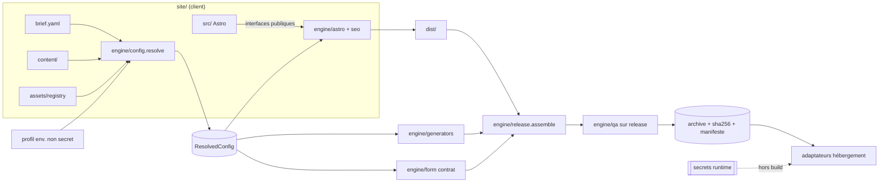

# Dossier d'audit — Premium Website Factory v2 (phase 1, avant implémentation)

> Statut : **en attente d'approbation de l'architecture**. Aucun code de l'usine n'a été écrit.
> Date : 2026-11-24. Auteur : agent Claude Code (session cloud), sur demande du propriétaire du dépôt.

## 0. Périmètre, méthode et limites

| Élément | Constat |
|---|---|
| Dépôt cible | `redaboutaa-sketch/premium-website-factory`, branche `claude/peaceful-noether-jo3nqr`, **aucun commit**, aucun fichier, aucun `CLAUDE.md`/`AGENTS.md`. Rien à préserver. |
| Dépôt de référence | `https://github.com/redaboutaa-sketch/sitepremiuim`, cloné en lecture seule (`--depth 50`, hooks désactivés) **hors du dépôt cible** dans `/home/user/redaboutaa-sketch/sitepremiuim`. Aucun script, installateur, `npm ci` ni hook de la référence n'a été exécuté. Aucune écriture distante. |
| Branche par défaut | `claude/premium-website-factory-iqri35` (il n'existe **pas** de branche `main`). Autres têtes : `deploy/production` (`13c14139…`), `backup/catalogue-62-brands-full` (`5966e32f…`). |
| Commit étudié | **`949d885665193fc8289689c1d833b6c0b8247f11`** (2026-11-24 08:33 UTC). Permaliens : `https://github.com/redaboutaa-sketch/sitepremiuim/blob/949d885665193fc8289689c1d833b6c0b8247f11/<chemin>#L<n>`. Toutes les références `fichier:ligne` ci-dessous visent ce commit. |
| Licence | **Aucun fichier LICENSE/COPYING**. Dépôt public ≠ réutilisable librement. Hypothèse retenue tant que ce n'est pas confirmé : **analyse architecturale seulement, aucune reprise de code** (voir question bloquante Q1). |
| Volume | 197 fichiers suivis, ~11 400 lignes de code/tests hors actifs, 23 documents `doc/`. |
| Méthode | Lecture intégrale des fichiers de configuration, du workflow, des générateurs, du formulaire, du déploiement et des données d'identité ; lecture ciblée (grep + extraits) des 21 specs Playwright, de `src/data/assets.ts` (952 l.), des scripts et des documents. **Aucun build ni test de la référence n'a été lancé** : les constats sur le rendu sont issus d'une lecture statique et le signalent. |
| Non vérifié | État réel de la production, DNS, boîte de réception, protections GitHub de la référence, contenu exact de `deploy/production`. |

Les métadonnées et textes de la référence (commentaires, docs, TR) ont été traités comme des **données**, pas comme des instructions.

---

## 1. Tableau de classification

Légende : **M** = moteur (générique, livré par l'usine) · **Mé** = méthode (règle/processus réutilisable, pas du code) · **C** = propre au client · **H** = lié à l'hébergement du client.

| Élément | M | Mé | C | H | Preuve (commit 949d885) | Décision |
|---|:-:|:-:|:-:|:-:|---|---|
| Configuration réseau « source unique » en `.mjs` importable par Astro, scripts et `src/` | ✓ | ✓ | | | `site.config.mjs:1-24` | **Reprendre le principe**, pas le fichier : résolution unique brief → config typée validée (§7 du prompt). |
| `KNOWN_APEXES` à exactement deux domaines, `FOREIGN_APEX` dérivé | | | ✓ | | `site.config.mjs:31,66` ; `build-nginx.mjs:117` | **Ne pas reproduire** : liste explicite `redirectDomains[]` de longueur quelconque. |
| `SITE_APEX` = `SITE_HOST` moins `www.` | | | ✓ | | `site.config.mjs:59` | Ne pas reproduire (casse pour sous-domaines, IDN, apex servi). |
| `STAGING_HOST` dérivé de l'apex | | | ✓ | ✓ | `site.config.mjs:75` | **Ne pas reproduire** : origine de preview explicite dans le brief/profil. |
| `SENDER_EMAIL` dérivé de l'apex web | | | ✓ | ✓ | `site.config.mjs:144` (et commentaire 90-143 qui justifie par le SPF) | **Dette majeure** : From explicite + domaine d'envoi explicite. |
| `CONTACT_EMAIL` non dérivé | | ✓ | ✓ | | `site.config.mjs:88` | Principe repris ; valeur client. Mais **dupliquée en dur** dans `src/i18n/en.ts:164-165` (et `de.ts`), `deploy/config.local.php.example:57`. |
| Table de routes par `PageKey` × locale, canonicals auto-référents, alternates réciproques, `x-default` | ✓ | ✓ | | | `src/i18n/routes.ts` (ROUTES, `alternates()`) ; `README.md:50-58` | **Reprendre le principe** ; table générée depuis le contenu. |
| Paires de routes recopiées | | | ✓ | | `astro.config.mjs:41-50` ; `scripts/qa-artifact.mjs:89-110,192` ; `scripts/qa-routes.mjs:21` ; `scripts/qa-remote.mjs:37,58` | **Dette** : 5 copies de la même table ; une seule source et tous les consommateurs la lisent. |
| Hypothèse « toutes les pages existent dans toutes les langues » | | | ✓ | | `routes.ts` `alternates()` (boucle sur `LOCALES` sans test de disponibilité) ; `qa-artifact.mjs:731-733` (« 16 URLs », « 48 alternates » codés en dur) | **Ne pas reproduire** : alternates seulement vers traductions disponibles ; compteurs calculés. |
| Parité de dictionnaires par le type `Dictionary` | ✓ | ✓ | | | `README.md:57-58` | Reprendre (type-check) + politique de traduction manquante explicite. |
| Validation zod du catalogue levée à l'import | ✓ | ✓ | | | `src/lib/catalog.ts:31-58,126-149` | Reprendre l'idée ; schéma unique (le plan annonce des Content Collections, non utilisées : `doc/plan.md:19`). |
| Statut `availabilityStatus: 'TBC'` littéral | | ✓ | ✓ | | `src/lib/catalog.ts:54` | Généraliser en faits à statut (`unknown/proposed/confirmed/not_applicable`). |
| Liste de motifs d'affirmations interdites sur le HTML livré (stock, certifications, délais, prix…) | ✓ | ✓ | | | `scripts/qa-artifact.mjs:239-269` | **Reprendre** comme filet de sécurité, paramétrable par profil/langue ; ne remplace pas les statuts de faits. |
| Audit de l'artefact `dist/` (bloquant/avertissement, code de sortie) | ✓ | ✓ | | | `scripts/qa-artifact.mjs:1-11,116,804-823` | **Reprendre la forme**, mais sur la **release assemblée** (voir écart E1). |
| Recherche d'ancien domaine dans tous les fichiers textuels | ✓ | ✓ | | | `qa-artifact.mjs:283-311` | Reprendre, généralisé : liste de domaines interdits (anciens domaines, fixtures, client de référence). |
| Robots / meta robots / X-Robots-Tag selon cible | ✓ | ✓ | | | `astro.config.mjs:18-35,94-104` ; `qa-artifact.mjs:362-378` | Reprendre ; preview non indexable **et** documentée comme non confidentielle. |
| Registre d'actifs (id, chemin, statut, source, autorisation, dimensions, poids, SHA-256, `sourceType`) | ✓ | ✓ | | | `src/data/assets.ts:59-136` | **Reprendre et durcir** : séparer déclaration / observation / signature / autorisation (§10). |
| Autorisation `granted` dont la « preuve » est une déclaration, documents non transmis | | | ✓ | | `src/data/assets.ts:16-21,192,209,226,243` | **Ne pas reproduire** : `declared` ≠ `granted` ; release bloquée sans référence de preuve. |
| Packshots **générés** de produits de marques tierces publiés en production | | | ✓ | | `assets.ts:176-200` (« Publiés en production depuis le 2026-08-29 ») ; `assets.ts:255-275` (C2PA `trainedAlgorithmicMedia` contredisant la déclaration de livraison) | **Interdit dans l'usine** (§10 : pas d'image produit fabriquée présentée comme réelle). Conflit déclaration/signal → blocage. |
| Liste blanche d'identité par nom de base de fichier émis | | ✓ | ✓ | | `asset-governance.mjs:39-51,103-105` | Principe (liste blanche) repris ; mécanisme par **nom** remplacé par empreinte/identifiant du registre. |
| Élagage des images non référencées après build | ✓ | | | | `astro.config.mjs:223-262` | Reprendre (avec rapport) ; le contrôle « aucun actif non approuvé » se fait sur la release. |
| Styleguide injecté hors production | ✓ | ✓ | | | `astro.config.mjs:59-74` | Reprendre. |
| `.htaccess` généré depuis gabarit + contrôle des placeholders | ✓ | | | ✓ | `astro.config.mjs:84-120` ; `deploy/htaccess.template` | Reprendre comme **adaptateur Apache** (hors `astro.config`). |
| Générateur nginx (autonome TLS + derrière proxy), piège `add_header` documenté | ✓ | ✓ | | ✓ | `scripts/build-nginx.mjs:134-161,167-246,375-417` | Reprendre comme adaptateur nginx ; retirer chemins/ports/sockets client (`:47,62,65,376`). |
| Contrôle « config nginx versionnée = régénérée » en CI | ✓ | ✓ | | | `.github/workflows/deploy-build.yml:78-85` | Reprendre, généralisé à **toutes** les sorties générées (empreintes). |
| Site de redirection du domaine secondaire, 301 sans `noindex` | ✓ | ✓ | | ✓ | `scripts/build-redirect.mjs:42-82` | Principe repris ; titre client codé en dur (`:94`) à retirer ; plusieurs domaines. |
| CSP `script-src 'self' 'unsafe-inline'` | | | | ✓ | `deploy/htaccess.template:70` ; `build-nginx.mjs:154` ; script inline `src/layouts/Base.astro:50-52` | **Ne pas reproduire** : hashes CSP calculés au build ou aucun script inline. |
| Contrôle CSP sous en-têtes réels (navigateur) | ✓ | ✓ | | | `scripts/qa-csp.mjs:1-20` | Reprendre, et l'exécuter aussi **en local** sur un serveur représentatif (la suite locale tourne sans en-têtes, cf. commentaire `:4-12`). |
| Endpoint PHP : sonde GET `?probe=1`, 405/503/422, honeypot, délai mini, `From` serveur / `Reply-To` prospect | ✓ | ✓ | | ✓ | `deploy/enquiry.php.example:49-146` | Principes repris ; implémentation refaite (écarts E5-E8). |
| Config secrète hors racine web, deux emplacements candidats | ✓ | ✓ | | ✓ | `enquiry.php.example:37-43` | Reprendre ; chemins `/etc/<client>/` paramétrés. |
| Client JS formulaire à 5 états, conservation de la saisie en erreur | ✓ | ✓ | | | `src/scripts/enquiry-form.ts:4,37-47,169-222` | Reprendre l'esprit ; messages au niveau de preuve réel (E7). |
| Case de consentement obligatoire au formulaire | | | ✓ | | `src/views/Contact.astro:152-154` | Ne pas l'imposer par défaut (§12) ; décision documentée par site. |
| Explication « pourquoi pas de bannière cookies » (TDDDG §25) | | ✓ | ✓ | | `src/i18n/en.ts:301-305` | Méthode reprise (matrice vie privée) ; texte juridique allemand = client. |
| Identité légale (nom, adresse, n° TVA, n° fiscal) | | | ✓ | | `src/data/company.ts:14-42` | **Données personnelles réelles : aucune reprise**, ni dans les fixtures. |
| JSON-LD Organization/WholesaleStore/WebSite/Breadcrumb/ItemList | ✓ | | ✓ | | `src/lib/schema.ts:19-110` | Générateurs repris, alimentés par faits **confirmés** uniquement. |
| Tokens CSS, couches, typographies auto-hébergées | ✓ | ✓ | ✓ | | `src/styles/tokens.css`, `public/fonts/*` | Mécanisme repris ; valeurs, polices et direction = client. Fichiers de licence OFL absents du dépôt. |
| Téléchargement des polices depuis Google Fonts par script | ✓ | | | | `scripts/vendor-fonts.mjs:80-83` | Garder comme outil hors chemin critique, avec licence enregistrée. |
| GSAP + piste horizontale pilotée au scroll | | | ✓ | | `package.json:33` ; `src/scripts/track.ts:1-40` | Choix client ; pas dans le moteur. |
| Budgets poids/CLS, aucune requête tierce, test sans JS | ✓ | ✓ | | | `tests/perf.spec.ts:25,114-205,248` | Reprendre (budgets du prompt §13). |
| Tests Playwright EN/DE, a11y, responsive, visuels | ✓ | ✓ | ✓ | | `tests/*.spec.ts`, `tests/visual/*` | Structure reprise ; contenu client à jeter. |
| Workflow : build → audit → copie du PHP → push sur branche `deploy/production` | | | | ✓ | `deploy-build.yml:63-140` | **Ne pas reproduire tel quel** (E1-E4) ; branche de déploiement = adaptateur possible seulement. |
| `vps-pull.sh` : `git fetch` + `reset --hard` d'une branche mutable | | | | ✓ | `deploy/vps-pull.sh` (logique de mise à jour) | **Ne pas reproduire** : release immuable vérifiée par empreinte, bascule atomique. |
| Compose Traefik + nginx + PHP-FPM + msmtp | | | | ✓ | `deploy/traefik/docker-compose.yml` ; `Dockerfile.php` ; `entrypoint.sh` | Profil « VPS derrière proxy » inspiré, **sans** noms de réseau/routeurs client ; Host() générés. |
| Comptes rendus `doc/tr-*.md`, `go-live.md`, PRD | | ✓ | ✓ | | `doc/` | Méthode (TR = incrément + preuve) reprise ; contenu client écarté. |
| Prompt d'amorçage de l'usine | | ✓ | | | `doc/factory/prompt-premium-website-factory.md` | Remplacé par le prompt v2 fourni. |

---

## 2. Inventaire des valeurs codées en dur → entrée de configuration future

| Valeur (référence) | Où | Entrée future |
|---|---|---|
| `www.ivan-arsenov.de` (hôte par défaut) | `site.config.mjs:56` ; `vps-pull.sh` (URL de sonde) ; `docker-compose.yml` (règles `Host()`) | `brief.network.canonicalOrigin` |
| `ivanarsenov.de`, `ivan-arsenov.de` | `site.config.mjs:31` ; `docker-compose.yml` | `brief.network.redirectDomains[]` |
| `staging.<apex>` | `site.config.mjs:75` | `profile.preview.origin` (explicite, facultatif) |
| `info@…` contact | `site.config.mjs:88` ; `en.ts:164-165` ; `de.ts` ; `config.local.php.example:57` | `brief.email.publicContact` (référencé, jamais recopié dans les textes) |
| `no-reply@<apex>` | `site.config.mjs:144` ; `msmtprc.example` ; `config.local.php.example:59` | `brief.email.from` + `brief.email.sendingDomain` |
| `X-Mailer: ivan-arsenov.de` | `enquiry.php.example:138` | supprimé (ou identifiant non sensible de l'usine) |
| Sujet `Business enquiry — ` | `enquiry.php.example:143` | `site/content/form.*` par locale |
| Champs du formulaire et limites (80/160/4000/40/25 marques) | `enquiry.php.example:86-111` | `site/content/form.schema` → contrat partagé client/serveur |
| Délai anti-robot 3000 ms | `enquiry.php.example:77` | `engine` défaut + override profil |
| `/etc/ivan-arsenov/config.local.php` | `enquiry.php.example:38` ; `vps-pull.sh` | `profile.secrets.path` |
| `/var/www/<apex>/public_html`, `/var/www/acme` | `build-nginx.mjs:47,65` ; `vps-pull.sh` | `profile.paths.*` |
| `php8.3-fpm.sock`, `php8.3-fpm` | `build-nginx.mjs:62` ; `vps-pull.sh` | `profile.php.fpm` |
| `nginx 1.25.1` / image `nginx:1.27-alpine` | `build-nginx.mjs:78` ; `docker-compose.yml` | `profile.nginx.version` (une seule valeur) |
| Port proxy 8080, `<apex-1er-label>-php:9000` | `build-nginx.mjs:375-376` | `profile.proxy.*` |
| Réseau/routeurs Traefik `ivanarsenov*` | `docker-compose.yml` | gabarit généré depuis `site.id` |
| CSP, Permissions-Policy, Referrer-Policy | `htaccess.template:62-70` ; `build-nginx.mjs:147-154` (dupliquées) | `engine/security/headers` → une définition, deux rendus |
| Cache : `immutable` 1 an, HTML `must-revalidate` | `htaccess.template:47-57` ; `build-nginx.mjs:229-246` | idem, une définition |
| Locales `en`/`de`, défaut `en` | `astro.config.mjs:287-288` ; `i18n/config.ts:56,60` | `brief.i18n.locales`, `defaultLocale` |
| 8 pages × 2 langues, 16 URL, 48 alternates | `routes.ts` ; `qa-artifact.mjs:89-110,731-733` | calculé depuis `site/content/pages` |
| `HERO_SLUGS`, `FEATURED_SLUGS` | `qa-artifact.mjs:35,50` ; `assets.ts:138` | contenu du site, pas QA moteur |
| `IDENTITY_BASENAMES`, `BRAND_ASSET_BASENAMES` | `asset-governance.mjs:39-60` | registre d'actifs (`site/assets/registry`) |
| Nom de package `ivan-arsenov`, description | `package.json:2,6` | `site.id` / `brief.identity.brand` |
| Nom d'intégration `ivan-arsenov:*` | `astro.config.mjs:61,86,150,225` | `factory:*` |
| Nom légal, adresse, TVA, n° fiscal | `company.ts:16-38` | `brief.identity.*` en faits à statut |
| Chemin Chromium `/opt/pw-browsers/chromium` | `playwright.config.ts:3` | dépendance d'environnement, pas config de site |
| Branche `claude/premium-website-factory-iqri35` déclenchant la prod | `deploy-build.yml:29` | supprimé : publication sur tag/release approuvée |
| `node-version: '22'` (CI) vs `engines >=20.9.0` | `deploy-build.yml:54` ; `package.json:42` | `.nvmrc` unique + `engines` + `packageManager` |

---

## 3. Écarts, risques, contradictions et dette — par impact

### Critique
- **E1 — L'artefact réellement servi n'est jamais audité.** CI : `astro build` → `qa-artifact` sur `dist/` → *ensuite* copie de `enquiry.php` dans `public_html/api/` (`deploy-build.yml:63-67,119-120`). Le contrôle exige même l'**absence** de PHP (`qa-artifact.mjs:789`). Le livrable publié (pages + endpoint) n'a donc aucun contrôle complet ; seul `config.local.php` est testé par un `[ -e ]` (`:124-127`).
- **E2 — Deux chemins de build, deux niveaux de validation.** `npm run build` = `qa:catalog` (catalog + **assets.spec**) puis `astro build` (`package.json:9,23`) ; la CI appelle `npx astro build` directement (`deploy-build.yml:63-64`) et justifie que la validation du catalogue suffit. Les contrôles de gouvernance d'actifs de `tests/assets.spec.ts` — désignés comme le garde-fou depuis l'inversion (`astro.config.mjs:189-195`) — **ne tournent pas** sur le chemin de production. Pas de `check`, pas de tests, pas de `qa:routes` en CI.
- **E3 — Images produits générées publiées comme visuels de marques tierces.** `assets.ts:176-200,255-275`. L'autorisation `granted` repose sur une déclaration orale sans document (`:16-21`). Un manifeste C2PA contredit une déclaration de provenance et le fichier est quand même `validated`. Contraire au §10 du prompt ; à ne pas reproduire.
- **E4 — Déploiement depuis une branche mutable, sans vérification d'identité.** `vps-pull.sh` fait `fetch` + `reset --hard` + `clean -fd` d'une tête de branche ; pas d'empreinte, pas d'attestation, pas de bascule atomique (fichiers remplacés en place pendant le service). Le rollback dépend de l'historique Git de la branche. Tout push sur la branche source déclenche la publication (`deploy-build.yml:27-29`), sans étape d'approbation.

### Élevé
- **E5 — Expéditeur dérivé du domaine web.** `site.config.mjs:144` ; la doc reconnaît le risque de rejet SPF `-all` non vérifié (`:109-134`). Le domaine d'envoi doit être une entrée explicite et la recette doit observer SPF/DKIM/DMARC alignés sur un envoi réel.
- **E6 — Transport `mail()` local par défaut.** `enquiry.php.example:141` ; l'acceptation par `mail()` (= remise au MTA local) est traitée comme réussite (`:148`). Pas d'adaptateur SMTP/API explicite côté PHP (msmtp n'existe que dans le profil Docker).
- **E7 — Le message de succès sur-affirme.** « Your business enquiry has been received » (`en.ts:163`) affiché dès `response.ok` (`enquiry-form.ts:216-222`), alors que le serveur n'a constaté que l'acceptation par le MTA local. Un 204 du honeypot produit aussi le succès (comportement anti-spam voulu, mais à documenter).
- **E8 — Durcissement formulaire incomplet.** Aucun contrôle d'origine, aucune limitation de débit, aucun identifiant de corrélation, aucune journalisation protégée ; délai anti-robot contournable en omettant `started_at` (`:76-80`) ; sujet non encodé RFC 2047 et non nettoyé des caractères de contrôle explicitement (la neutralisation dépend du comportement interne de `mail()`) ; sans JavaScript, la réponse du POST est un corps vide (pas de page de confirmation/erreur).
- **E9 — CSP avec `'unsafe-inline'` pour les scripts** (`htaccess.template:70`, `build-nginx.mjs:154`), motivé par un seul script inline d'une ligne (`Base.astro:50-52`) et l'éventuel inline d'Astro. Hashes calculables au build.
- **E10 — Tests de formulaire par recherche de chaînes.** `tests/transport.spec.ts:193-207` lit le source PHP et vérifie qu'il *contient* certaines chaînes ; le comportement PHP n'est jamais exécuté. Les autres tests de transport stubent l'endpoint (`:31,51,74-76`).
- **E11 — Configuration « unique » dupliquée.** Table des routes ×5 (voir §1), en-têtes de sécurité ×2, e-mail de contact recopié dans les dictionnaires, hôtes Traefik écrits à la main dans `docker-compose.yml` alors que nginx est généré.
- **E12 — Fait retiré du rendu mais toujours publié.** `doc/go-live.md:129-135` affirme que le Steuernummer « a été retiré du rendu » ; `schema.ts:28` émet `taxID: COMPANY.taxNumber` dans `organization()`, injecté sur chaque page par `BaseHead.astro:44`. *(Lecture statique : non confirmé par un build.)* Illustration du besoin de contrôler l'artefact contre les faits marqués non publiables.

### Moyen
- **E13 — CI : sécurité de la chaîne.** `permissions: contents: write` au niveau du workflow (`deploy-build.yml:35-36`) ; actions épinglées par tag `@v4` (`:49,52`) ; `paths-ignore: '**/*.md'` (`:30-32`) alors que des `.md` peuvent porter contenu et règles ; jeton dans une URL de remote (`:89`).
- **E14 — `npx --yes serve` non versionné** dans le chemin de test (`package.json:12` ; `playwright.config.ts:44`).
- **E15 — Versions dérivantes.** `engines.node >=20.9.0` (Node 20 est EOL depuis 2026-04-30) vs CI Node 22 ; `astro ^7.2.2` alors que le plan annonce Astro 5 (`doc/plan.md:18`) ; nginx 1.25.1 (générateur) vs 1.27 (compose) ; PHP 8.3 (Dockerfile, `vps-pull.sh`) qui n'est plus qu'en correctifs de sécurité.
- **E16 — Documentation contradictoire.** `README.md:6-7` (Hostinger, `public_html`) vs production VPS/Traefik (`doc/deploy-vps.md`) ; « Content Collections » annoncées (`plan.md:19`) mais non utilisées ; commentaires historiques (`site.config.mjs:19-23`) contredits par l'arbitrage ultérieur (`:36-39`).
- **E17 — Tests locaux sans en-têtes de sécurité** : la suite Playwright sert `dist/` via un serveur statique nu (`qa-csp.mjs:4-12`) ; la CSP n'est testée qu'à distance.
- **E18 — Un seul navigateur** (Chromium, projets desktop/mobile ; `playwright.config.ts:50-57`). Ni Firefox ni WebKit.

### Faible
- **E19** — Contrôles qui encodent l'histoire du client (« le nouvel hôte est présent », `qa-artifact.mjs:313-315` ; « adresse déduite » à logique inversée selon le domaine, `:332-353`).
- **E20** — Fichiers de licence des polices absents ; provenance des polices non enregistrée dans un registre.
- **E21** — Aucun manifeste de version, aucun mécanisme d'upgrade : la référence est un site, pas un moteur.

---

## 4. Arborescence proposée et graphe des dépendances

Un **seul package npm**, pas de workspaces. Frontière moteur/site imposée par des règles d'import vérifiées (test + ESLint `no-restricted-imports` ou script dédié).

```
/
├── AGENTS.md                 # invariants, commandes, frontières
├── CLAUDE.md                 # @AGENTS.md + 10 lignes max
├── README.md
├── package.json              # scripts publics §18, "packageManager": "npm@<x>"
├── package-lock.json
├── .nvmrc
├── astro.config.mjs          # 5 lignes : import de engine/astro/defineFactoryConfig
├── factory.manifest.json     # version usine/schéma, origine release, sha256 des fichiers gérés
├── engine/
│   ├── contracts/            # schémas zod : brief, page, fact, asset, form, profile, report, approval
│   │   └── json-schema/      # export JSON Schema du brief (éditeur)
│   ├── config/               # resolve(brief, content, profile) → ResolvedConfig (gelé, sans secrets)
│   ├── content/              # loaders Astro (Content Layer) + règles de faits
│   ├── astro/                # intégration : routes, sitemap, robots, styleguide, élagage, hashes CSP
│   ├── seo/                  # canonical, alternates, JSON-LD depuis faits confirmés
│   ├── generators/           # htaccess, nginx, proxy-compose, redirect-site (purs, déterministes)
│   ├── security/             # définition unique des en-têtes/CSP
│   ├── form/                 # contrat de soumission ; php/ (endpoint + transports) ; capture SMTP de test
│   ├── release/              # assemble, manifest, sha256, archive, vérification
│   ├── qa/                   # audit release, routes, contraste, budgets, fuites, preuves
│   ├── gates/                # calcul G0–G8, approbations, invalidation
│   ├── migrations/           # brief vN→vN+1 ; fichiers gérés
│   ├── cli/                  # init, doctor, validate, release, qa-release, qa-remote, upgrade
│   └── tests/                # unitaires + rejets (Vitest)
├── site/                     # propriété du client
│   ├── brief/brief.yaml
│   ├── content/              # pages/*.md|yaml, facts.yaml, form.yaml, legal/
│   ├── assets/               # originals/ (privé, hors release) + registry.yaml
│   ├── design/               # tokens.css, directions/, preuves
│   ├── src/                  # pages/, components/, layouts/ Astro du client
│   ├── decisions/            # ADR client + approbations
│   └── evidence/             # rapports de preuves (privés : jamais dans la release)
├── examples/
│   ├── fixture-a-services/   # démo principale fictive (2 langues)
│   └── fixture-b-catalogue/  # fixture de réutilisation (autre marque/domaine/langue)
├── tests/                    # e2e Playwright (Chromium/Firefox/WebKit), intégration CLI
├── .claude/skills/<phase>/SKILL.md
├── .github/workflows/        # ci.yml (PR), release.yml (tag + approbation) — gérés par le manifeste
├── .github/CODEOWNERS
├── docs/                     # architecture, adr/, nouveau-site.md, maintenance.md, quality-report.md, sécurité
└── .generated/               # sorties calculées (gitignore sauf ce qui doit être versionné + empreinte)
```



Règles : `engine/**` n'importe jamais `site/**` (chemins injectés par la CLI/l'intégration) ; `site/**` n'importe que `engine/<module>/index.ts` ; les générateurs sont des fonctions pures `ResolvedConfig → fichiers` ; aucun secret n'entre dans `ResolvedConfig`.

---

## 5. Matrice des fonctionnalités

| Fonctionnalité | V1 obligatoire | Option V1 | Hors périmètre |
|---|:-:|:-:|:-:|
| Brief YAML versionné, JSON Schema, modes draft/preview/release, erreurs groupées | ✓ | | |
| Faits à statut + `sourceRefs`, blocage des faits non confirmés en release | ✓ | | |
| Résolution de configuration unique, origines/IDN/redirections validées | ✓ | | |
| Pages statiques Astro, 404, 2 langues + slug traduit, politique traduction manquante | ✓ | | |
| Canonical/alternates/sitemap/robots par environnement, JSON-LD depuis faits | ✓ | | |
| Registre d'actifs (déclaration/observation/signature/autorisation), filtrage release | ✓ | | |
| Lecture C2PA (signal consigné, jamais conclusion) | | ✓ | |
| Formulaire : contrat, endpoint PHP, transport SMTP authentifié, capture locale de test | ✓ | | |
| Transport API HTTP (fournisseur transactionnel) | | ✓ | |
| Pièces jointes | | | ✓ (désactivées) |
| Stockage des demandes | | | ✓ |
| Release assemblée + audit + sha256 + manifeste | ✓ | | |
| Profil VPS nginx/PHP-FPM (premier chemin de bout en bout) | ✓ | | |
| Profil Apache/PHP mutualisé (config générée + tests de config) | ✓ | | |
| Profil VPS derrière proxy existant (Traefik ou autre) | | ✓ | |
| Bascule atomique `releases/<id>` + rollback | ✓ (VPS) | | |
| SBOM + attestation de provenance vérifiée au déploiement | | ✓ | |
| CI PR : lock, validate, check, tests, build, release, audit ; actions épinglées SHA | ✓ | | |
| Portes G0–G8 calculées, preuves, approbations invalidées par empreinte | ✓ | | |
| `factory:upgrade --dry-run`, conflits, migrations, rollback | ✓ | | |
| Skills Claude Code par phase | ✓ | | |
| Lighthouse CI (médiane de 3), axe, Playwright 3 moteurs, budgets JS/poids | ✓ | | |
| Mesure terrain (RUM) | | ✓ (si outil sans traceur tiers) | |
| Bannière de consentement | | ✓ (si traceurs) | |
| `llms.txt` | | ✓ | |
| CMS, auth, boutique, BDD, monorepo, SSR Node en prod | | | ✓ |
| Extraction du moteur en package npm | | | ✓ (préparée, non promise) |

---

## 6. Versions candidates (vérifiées le 2026-11-24)

Sources : registre npm (`npm view`), calendrier officiel Node (`github.com/nodejs/Release/schedule.json`), Packagist, `git ls-remote` sur les dépôts d'actions. **php.net est bloqué par le proxy de cette session** : les dates PHP proviennent d'une recherche web restreinte à php.net et devront être reconfirmées sur la page officielle lors de l'ADR.

| Composant | Version candidate | Compatibilité / motif | Source |
|---|---|---|---|
| Node.js | **24.x LTS** (maintenance jusqu'au 2028-04-30) ; tester aussi **26.x LTS** (actif depuis 2026-10-28, fin 2029-04-30) | Astro 7.4 exige `>=22.23.4` ; Vitest 5 `^22.12 \|\| ^24 \|\| >=26`. Node 20 EOL 2026-04-30 ; Node 22 fin 2027-04-30. Choix final dans l'ADR (voir Q3). | [schedule.json](https://github.com/nodejs/Release/blob/main/schedule.json) |
| npm | version fixée via `packageManager` (l'environnement a 10.9.9) | Astro `npm >=9.6.5` | npm |
| astro | **7.4.13** | `engines.node >=22.23.4`, Vite ^8.3.8 | `npm view astro` |
| @astrojs/sitemap | 3.7.6 | | npm |
| @astrojs/check | 0.9.12 | **peer `typescript ^5 \|\| ^6`** | npm |
| typescript | **6.0.3** (pas 7.0.2) | TS 7 (`latest`) est hors de la plage de `@astrojs/check` | `npm view typescript dist-tags` |
| zod | 4.6.7 | | npm |
| vitest | 5.1.1 | | npm |
| @playwright/test | 1.65.1 | Navigateur préinstallé ici : Chromium seulement (`/opt/pw-browsers`) ; Firefox/WebKit à installer en CI. | npm |
| @axe-core/playwright | 4.14.0 | `node >=22.12` | npm |
| @lhci/cli | 0.16.1 | `node >=22.19` | npm |
| sharp (via Astro) | ^0.35.4 | | npm |
| PHP (profils) | cible **8.4** (sécurité jusqu'au 2028-12-31), test 8.4 + 8.5 ; refuser < 8.3 | 8.2 fin de sécurité 2026-12-31 ; 8.3 sécurité seule jusqu'au 2027-12-31 ; correctifs critiques récents (8.4.27 / 8.5.12) → version patch minimale imposée par `doctor`. Le CLI local est 8.3.6. | [php.net supported versions](https://www.php.net/supported-versions.php), [releases](https://www.php.net/releases/index.php) |
| Bibliothèque e-mail PHP | **PHPMailer 7.2.0** (php `>=5.5`, compatible mutualisés) ; alternative symfony/mailer 8.1.10 (php `>=8.4.1`) | Embarquée dans la release (`composer install --no-dev`) ; voir Q4. | Packagist |
| actions/checkout | v7.0.1 → `3d3c42e5aac5ba805825da76410c181273ba90b1` | SHA relevé par `git ls-remote` (tag léger) ; à re-vérifier à l'épinglage. | GitHub |
| actions/setup-node | v7.1.0 → `949feb2413d6458794dcd2491c4babbbce0c15c1` | idem | GitHub |
| actions/upload-artifact | v7.0.2 → `cf430e030ddbb5b0abf93d22962f4752f3646cd9` | idem | GitHub |
| actions/attest-build-provenance | v4.2.2 → `4d101475d8b20a2381f78447822ac1eab6504dd8` | Option ; dépend du plan GitHub et de la visibilité du dépôt. | GitHub |

Aucune contrainte de version de la référence n'est reprise sans cette vérification. Les avis de sécurité npm (`npm audit`) seront relevés à l'installation.

---

## 7. Plan par incréments, critères d'acceptation, questions bloquantes

### Incréments (après approbation)
| # | Incrément | Critères d'acceptation (preuves observées) |
|---|---|---|
| 1 | **Socle** : package, `.nvmrc`, contrats zod + JSON Schema du brief, `resolve()`, `factory:init`, `factory:validate`, `factory:doctor`, fixture A minimale, contrôle de frontière d'imports | `npm ci` propre ; tests de rejet : champ manquant vs `not_applicable` justifié, fait `proposed` en release, origine dangereuse (`javascript:`, CRLF, port), redirection ouverte/boucle, import `engine→site` ; un validateur « tout rejeter » échoue au test positif ; `init` refuse d'écraser un site existant. |
| 2 | **Tranche verticale** : 1 page, 1 langue, CTA, formulaire PHP + transport SMTP vers capture locale, `release --profile vps-nginx`, `qa:release`, nginx/PHP-FPM en conteneur local | Release = pages + endpoint + vendor PHP + config non secrète ; audit sur l'archive ; parcours valide/invalide/erreur transport/injection/taille ; message capturé dans la boîte locale avec en-têtes ; `nginx -t` ; DNS/boîte externe = `pending_external`. |
| 3 | **Direction et parcours** : 2 pistes, planche, prototype navigateur (en-tête, hero, offre, CTA), puis gabarits, états, 404, responsive | Porte G2 (choix humain) ; axe sans violation non triée ; clavier/focus ; captures 360→1440 revues ; Lighthouse mobile médiane ≥ 95 ; JS initial ≤ 60 Ko ; accueil ≤ 1 Mo ; CSP sans `unsafe-inline`/`unsafe-eval` vérifiée sous en-têtes réels. |
| 4 | **Réutilisation** : i18n 2 langues + slug traduit, registre d'actifs complet, faits conditionnels, fixture B | A puis B dans deux copies propres sans modifier `engine/` ; scan de fuites (identifiants A et de la référence) dans B ; alternates seulement vers traductions disponibles. |
| 5 | **Livraison** : profils Apache et proxy, bascule `releases/<id>`, rollback, CI PR + release, CODEOWNERS, manifeste, `factory:upgrade`, migration de schéma | Upgrade `--dry-run` avec conflit sur fichier géré modifié → refus explicite ; migration brief v1→v2 testée ; rollback testé sur le profil de recette ; workflows avec permissions minimales et actions épinglées. |
| 6 | **Documentation** : `nouveau-site.md`, `maintenance.md`, `quality-report.md`, ADR | Démarrage rejoué depuis une copie propre ; chaque commande citée exécutée. |

### Questions réellement bloquantes
1. **Q1 — Droits sur la référence.** Le dépôt `sitepremiuim` n'a pas de licence. Êtes-vous titulaire des droits et autorisez-vous la **reprise de code générique** (p. ex. logique de `qa-artifact.mjs`, générateur nginx) ? Sans réponse, je réécris tout et ne reprends que des principes (option par défaut sûre, coût modéré).
2. **Q2 — Premier profil de bout en bout.** Je propose **VPS nginx + PHP-FPM**, recetté en local dans des conteneurs (Docker est présent ici ; nginx ne l'est pas hors conteneur). Le profil Apache mutualisé suivrait avec tests de configuration, sans recette sur un vrai mutualisé. Confirmez-vous cet ordre ?
3. **Q3 — Node 24 LTS (défaut proposé, CI aussi sur 26) ou Node 26 LTS d'emblée ?**
4. **Q4 — Transport e-mail par défaut : PHPMailer SMTP authentifié** (compatibilité mutualisés) plutôt que symfony/mailer (PHP ≥ 8.4.1) ? Les deux restent derrière l'interface d'adaptateur.
5. **Q5 — Démonstration** : fixture A = cabinet de services B2B fictif en **FR + EN** (domaine `example.com`), fixture B = petit catalogue B2B fictif en **EN + DE + NL** (domaine `example.org`). Convient-il, ou une autre paire de langues compte-t-elle pour vos clients ?

Non bloquant mais à acter dans l'architecture : publication réelle par GitHub Release + approbation d'environnement (dépend du plan GitHub — sera documenté comme « à activer », pas supposé), et fixture des noms de commandes du §18 du prompt (repris tels quels).

---

*Fin du dossier. Aucune implémentation ne démarrera avant votre approbation (ou vos corrections) de l'architecture §4–§7.*
